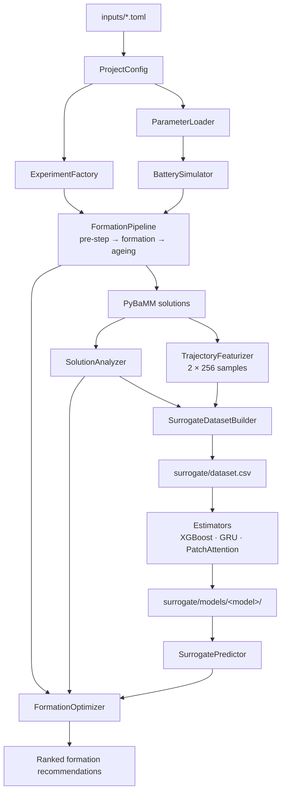

# Battery Formation Recommendation

This project evaluates lithium-ion battery formation protocols with PyBaMM,
trains surrogate ageing models (XGBoost, GRU and a custom patch Transformer),
and ranks formation choices with multi-criteria optimisation (MCO).

The codebase is organised so that configuration, electrochemical simulation,
surrogate modelling and recommendation logic can be changed independently.
Runtime values belong in TOML files under `inputs/`, and every TOML file is
commented with the options it accepts. Python classes implement the behaviour
that uses those values. Every module, class and non-trivial function has a
docstring describing what it does.

## Project Layout

```text
formation_recommendation_system/
├── inputs/
│   ├── config.py               TomlConfig, ProjectConfig
│   ├── logs.py                 setup_logging -> formation_system.log
│   ├── parameters.toml         PyBaMM cell parameters
│   ├── simulation.toml         DFN options, experiments, tracked outputs
│   ├── surrogate.toml          dataset, features, CV split, plots
│   ├── mco.toml                recommendation grid, weights, surrogate choice
│   └── models/
│       ├── xgboost.toml        XGBoost hyper-parameters
│       ├── gru.toml            GRU hyper-parameters
│       └── custom.toml         PatchAttention hyper-parameters
├── simulations/
│   ├── parameters.py           ParameterLoader
│   ├── experiments.py          FormationCandidate, ExperimentFactory
│   ├── runner.py               BatterySimulator
│   ├── pipeline.py             FormationPipeline
│   ├── analysis.py             SolutionAnalyzer
│   └── plotting.py             ResultPlotter
├── surrogate/
│   ├── targets.py              TARGETS = capacity, plating, sei, resistance
│   ├── features.py             TrajectoryFeaturizer
│   ├── dataset.py              SurrogateDatasetBuilder
│   ├── create_dataset.py       entry point: build dataset.csv
│   ├── evaluation.py           metrics, CV summary, trajectory plots
│   ├── train_models.py         entry point: train models
│   ├── predictor.py            SurrogatePredictor (used by the MCO)
│   ├── validate_protocol.py    entry point: surrogate vs PyBaMM on one protocol
│   └── estimators/
│       ├── __init__.py         model registry (ESTIMATORS)
│       ├── base.py             SurrogateEstimator
│       ├── xgboost_estimator.py
│       ├── torch_data.py       FormationDataset, protocol folds
│       ├── torch_estimator.py  TorchEstimator (shared PyTorch training loop)
│       ├── gru_estimator.py    FormationGRU, GRUEstimator
│       └── custom_estimator.py PatchAttention, CustomEstimator
├── mco/
│   └── optimizer.py            CandidateGrid, CandidateScorer, FormationOptimizer
├── run_simulation.py           entry point: one detailed simulation
├── run_recommendation.py       entry point: MCO ranking
├── Model.md                    PatchAttention model description
└── README.md
```

Generated artifacts stay next to the code that produces them:

```text
surrogate/dataset.csv               one row per (protocol, ageing cycle)
surrogate/failed_candidates.csv     protocols PyBaMM could not simulate
surrogate/models/<model>/           model file(s), metadata.json, cv_predictions.csv
surrogate/plots/<model>/            trajectory plots, learning curve (if [plots] enabled)
mco/results/                        all_candidates.csv, top_candidates.csv, failed_candidates.csv
plots/                              run_simulation.py output plots
formation_system.log                log of every entry point (metrics, timings, rankings)
```

These paths are ignored by Git.

## System Flow



## Installation

Activate the virtual environment:

```bash
source .venv/bin/activate
```

Install dependencies when required (PyBaMM, PyTorch, XGBoost, scikit-learn,
pandas, matplotlib):

```bash
python3 -m pip install -r requirements.txt
```

XGBoost requires an OpenMP runtime. On macOS with Homebrew:

```bash
brew install libomp
```

Installing the Python `xgboost` package alone is not enough when
`libomp.dylib` is unavailable.

Run every command from the project root. Package commands use `-m`:

```bash
python3 -m surrogate.create_dataset
python3 -m surrogate.train_models --model custom
```

## Input Configuration

Each TOML file starts with a header that names the code that reads it, says
whether changes need a new dataset or only retraining, and lists the valid
options next to each key.

### `inputs/parameters.toml`

Contains the complete PyBaMM parameter set. It starts from the Mohtat2020
values, and project-specific overrides are appended at the end; a later entry
with the same name wins.

```toml
[[parameter]]
name = "Negative electrode reaction-driven LAM factor [m3.mol-1]"
type = "float"            # float, int, str, list or function
value = 1e-4
```

Function-valued parameters use an import reference:

```toml
type = "function"
value = "pybamm.input.parameters.lithium_ion.Mohtat2020:function_name"
```

Change this file for cell geometry or nominal capacity, electrode or
electrolyte properties, SEI, plating, thermal or LAM coefficients, initial
concentrations or temperatures. `ParameterLoader` in `simulations/parameters.py`
converts the entries into `pybamm.ParameterValues`.

### `inputs/simulation.toml`

Owns all settings for a PyBaMM simulation.

| Section | Purpose |
|---|---|
| `[solver]` | IDAKLU relative and absolute tolerances |
| `[model.options]` | Passed unchanged to `pybamm.lithium_ion.DFN`: SEI, plating, thermal, porosity, LAM sub-models |
| `[experiments]` | `pre_step` (runs once before formation) and one `aging` cycle (repeated) as PyBaMM experiment strings |
| `[formation]` | Charge/discharge voltage cutoffs, shared by all scripts, plus the default protocol for `run_simulation.py` (x1 = 0.1 C, x2 = 0.1 C, x3 = 0.1 min, x4 = 3) |
| `[capacity_check]` | Slow C/20 check-up used by `run_simulation.py` to measure capacity and ECM resistance |
| `[run]` | Ageing cycles and plot directory for `run_simulation.py` |
| `[[outputs]]` | Tracked ageing metrics: `key`, `label`, PyBaMM `variable`, plot `filename`, `aggregation` |

`aggregation = "discharge_step"` measures Ah delivered in the cycle's last
step; `aggregation = "end"` takes the variable's value at the end of the
cycle. The four keys `capacity`, `plating`, `sei` and `resistance` are the
surrogate targets and MCO objectives (`surrogate/targets.py`).

### `inputs/surrogate.toml`

Controls dataset creation, features, cross-validation and plots for every
surrogate.

| Section | Keys |
|---|---|
| `[paths]` | `dataset`, `failed_candidates`, `models_dir`, `plots_dir`; each model writes to `<dir>/<model>/` |
| `[data]` | `aging_cycles` (500), `training_ageing_mesh` (target cycles, currently `[1, 500]`), `trajectory_feature_count` (256) |
| `[signals]` | PyBaMM variable names for time, terminal voltage and current |
| `[grid]` | Training protocols: 4 charge rates × 4 discharge rates × 4 rests × 2 cycle counts = 128 |
| `[split]` | `cv_folds = 7`, `validation_fraction_of_train = 0.18`, `random_state`; splits are by protocol |
| `[plots]` | `enabled`, `max_test_protocols` |

The featurizer resamples **voltage and current** at 256 evenly spaced times
over the formation, using linear interpolation. Each protocol therefore gives
2 × 256 = 512 formation features. XGBoost also receives the ageing cycle as
an input, while the PyTorch models read the 512 values as a `(256, 2)`
sequence.

### `inputs/models/<model>.toml`

Each surrogate reads its hyper-parameters from its own file. Changing them
only needs retraining.

| File | Contents |
|---|---|
| `xgboost.toml` | Passed unchanged to `xgboost.XGBRegressor`; one regressor per target |
| `gru.toml` | `sequence_stride`, GRU size, head size, dropout, plus training keys |
| `custom.toml` | `sequence_stride`, `patch_len`, `d_model`, `n_heads`, `ffn_size`, `n_blocks`, `dropout`, plus training keys |

Training keys shared by the PyTorch models: `input_noise_std`,
`learning_rate`, `weight_decay` (AdamW), `batch_size`, `max_epochs`,
`patience`, `min_delta`, `grad_clip_norm`, `seed` and `device`. A key left
out of a PyTorch model's file falls back to the estimator's `DEFAULTS`, then
to `DEFAULT_TRAINING` in `surrogate/estimators/torch_estimator.py`.

### `inputs/mco.toml`

| Section | Keys |
|---|---|
| `[recommendation]` | `mode`, `surrogate_model`, `top_n`, `aging_cycles`, `prediction_cycles`, `results_dir` |
| `[grid]` | Candidate values of `x1_charge_rate`, `x2_discharge_rate`, `x3_rest_minutes`, `x4_num_cycles` (Cartesian product) |
| `[weights]` | Weight per objective: formation time, final capacity, capacity fade, plating, SEI and resistance growth |

`mode` decides how ageing is evaluated:

- `"auto"`: use the surrogate if it is trained, otherwise PyBaMM.
- `"surrogate"`: always use the surrogate.
- `"pybamm"`: always run full PyBaMM ageing.

`surrogate_model` picks `"xgboost"`, `"gru"` or `"custom"`, and that model
must already be trained. The first and last `prediction_cycles` are the
"start" and "final" points of the score; keep them within the training mesh.

## Simulation Classes

| Class | Location | Role |
|---|---|---|
| `TomlConfig`, `ProjectConfig` | `inputs/config.py` | Read every TOML file; resolve relative paths from the project root |
| `ParameterLoader` | `simulations/parameters.py` | `parameters.toml` → `pybamm.ParameterValues` |
| `FormationCandidate` | `simulations/experiments.py` | One protocol: x1 charge rate, x2 discharge rate, x3 rest minutes, x4 cycles |
| `ExperimentFactory` | `simulations/experiments.py` | Builds pre-step, formation, ageing and capacity-check experiments |
| `BatterySimulator` | `simulations/runner.py` | DFN model + IDAKLU solver; solves one experiment, optionally from a previous state |
| `FormationPipeline` | `simulations/pipeline.py` | Pre-step (run once, cached) → formation → ageing, with state hand-over; used by every script |
| `SolutionAnalyzer` | `simulations/analysis.py` | Drops zero-duration carry-over cycles; reads metrics at given cycles; capacity and resistance check-ups |
| `ResultPlotter` | `simulations/plotting.py` | One plot per `[[outputs]]` metric |

## Surrogate Models

Three surrogates share the same dataset, the same protocol-level 7-fold
cross-validation (`[split]`), the same metrics (MAE, RMSE, R², MAPE) and the
same result files. Every model is registered in
`surrogate/estimators/__init__.py` and keeps its files in
`surrogate/models/<model>/`.

| Model | Code | Inputs | Cycle handling |
|---|---|---|---|
| XGBoost | `xgboost_estimator.py` | 512 flat features + ageing cycle; one regressor per target | Cycle is an input feature |
| GRU | `gru_estimator.py` | `(256, 2)` sequence pooled to 64 steps; GRU encoding + log-cycle → MLP head | Cycle is an input to the head |
| PatchAttention (`custom`) | `custom_estimator.py` | `(256, 2)` sequence → channel-mixed patches → 2 pre-norm Transformer blocks → flatten head | Predicts all mesh cycles in one step; other cycles interpolated in log-cycle |

**PatchAttention** is described fully in [Model.md](Model.md). It currently
works best with `sequence_stride = 1`, which means no Haar/average-pool
reduction. With `stride = 2`, it already beat the GRU on test MAE for all
four targets:

| Test MAE (mean of 7 folds) | capacity | plating | sei | resistance |
|---|---|---|---|---|
| GRU | 0.0091 | 0.0075 | 3.8e-4 | 3.1e-4 |
| PatchAttention (stride 2, patch 8, d_model 32) | 0.0068 | 0.0059 | 3.0e-4 | 1.6e-4 |

### Shared training behaviour

- **Splits:** all ageing cycles of one protocol stay in the same split, so a
  protocol never appears in both train and test. Each fold tests about 1/7 of
  the protocols. The PyTorch models hold out 18 % of the remaining protocols
  for early stopping.
- **XGBoost:** a `SimpleImputer → StandardScaler → XGBRegressor` pipeline per
  target. The final model is fitted on every protocol.
- **PyTorch (GRU and PatchAttention):** the `TorchEstimator` training loop.
  - Standardisation of inputs, log-cycle and targets, fitted on training
    protocols only.
  - MSE loss with missing targets masked out.
  - AdamW, gradient clipping and optional input noise.
  - Early stopping, with the best epoch's weights restored.
  - The final model is refitted on all protocols except a validation share.
  - The model is saved as `<model>.pt`, holding the parameters and weights.
- **Outputs:** per-fold metrics and the cross-validation summary go to
  `formation_system.log`. Out-of-fold test predictions go to
  `cv_predictions.csv`, and the final-model description to `metadata.json`.
  With `[plots] enabled = true`, every model writes out-of-fold trajectory
  plots, and the PyTorch models also write a learning curve.
- **Isolation:** training several models launches one subprocess per model,
  because XGBoost and PyTorch use conflicting OpenMP runtimes on macOS.

### Surrogate classes

| Class | Location | Role |
|---|---|---|
| `TrajectoryFeaturizer` | `surrogate/features.py` | Formation solution → 256 voltage + 256 current samples evenly spaced in time |
| `SurrogateDatasetBuilder` | `surrogate/dataset.py` | Pre-step → formation → features → ageing → targets at the mesh cycles, for every grid protocol |
| `SurrogateEstimator` | `surrogate/estimators/base.py` | Base class: dataset loading and result files |
| `XGBoostEstimator` | `surrogate/estimators/xgboost_estimator.py` | XGBoost model |
| `FormationDataset` | `surrogate/estimators/torch_data.py` | One item per protocol: sequence `(time, 2)` and targets `(cycles, 4)` |
| `TorchEstimator` | `surrogate/estimators/torch_estimator.py` | Shared PyTorch CV, training, saving and loading |
| `GRUEstimator` | `surrogate/estimators/gru_estimator.py` | GRU model |
| `CustomEstimator` | `surrogate/estimators/custom_estimator.py` | PatchAttention model |
| `SurrogatePredictor` | `surrogate/predictor.py` | Loads the trained model chosen in `mco.toml` once and checks its feature columns match |

## MCO Classes

Location: `mco/optimizer.py`

| Class | Role |
|---|---|
| `CandidateGrid` | Cartesian product of the `[grid]` values in `mco.toml` |
| `CandidateScorer` | Min-max normalises each objective over all candidates into a 0–1 penalty and sums the weighted penalties. Lower scores are better; final capacity is higher-is-better, the rest lower-is-better |
| `ResultRepository` | Writes all, top and failed candidates to `mco/results/` |
| `FormationOptimizer` | For each candidate: PyBaMM formation, then ageing metrics from the surrogate or PyBaMM; then scores, ranks and saves |

## Entry Points

### Create the surrogate dataset

```bash
python3 -m surrogate.create_dataset
```

An existing dataset is reused. To regenerate it:

```bash
python3 -m surrogate.create_dataset --force
```

For a quick pipeline test:

```bash
python3 -m surrogate.create_dataset --force --limit-candidates 2
```

### Train surrogate models

This never runs PyBaMM; it needs an existing `surrogate/dataset.csv`.

```bash
python3 -m surrogate.train_models --model custom
```

```bash
python3 -m surrogate.train_models --model xgboost gru custom
```

```bash
python3 -m surrogate.train_models --model all
```

With no `--model`, only XGBoost is trained. The console prints the mean test
metrics, and the full fold-by-fold tables go to `formation_system.log`.

### Validate a trained surrogate on one protocol

Runs PyBaMM (pre-step, formation and ageing up to the largest requested
cycle) and compares it with the surrogate's prediction from the same
formation. The protocol may lie off the training grid.

```bash
python3 -m surrogate.validate_protocol --x1 0.1 --x2 0.5 --x3 30 --x4 3
```

```bash
python3 -m surrogate.validate_protocol --x1 0.1 --x2 0.5 --x3 30 --x4 3 --model gru
```

```bash
python3 -m surrogate.validate_protocol --x1 0.1 --x2 0.5 --x3 30 --x4 3 --cycles 1 100 500
```

Without `--model`, it uses `surrogate_model` from `mco.toml`, and the default
cycles are the `training_ageing_mesh`. Per-target MAE and MSE, plus their mean
across the four targets, go to `formation_system.log`. Cycles outside the
training mesh trigger a warning.

### Run one detailed simulation

```bash
python3 run_simulation.py
```

This runs the `[formation]` default protocol from `simulation.toml`, then a
C/20 check, ageing for `[run] aging_cycles`, and another C/20 check. It logs
the capacity and resistance check-ups and writes one plot per output. Use it
to verify a recommended protocol by copying it into `[formation]`.

### Run formation recommendations

```bash
python3 run_recommendation.py
```

Writes `all_candidates.csv`, `top_candidates.csv` and `failed_candidates.csv`
to `mco/results/`. The ranking also goes to `formation_system.log`.

## What Should I Modify?

| Goal | Modify |
|---|---|
| Change cell or degradation parameters | `inputs/parameters.toml` |
| Change DFN options or solver tolerances | `inputs/simulation.toml` |
| Change the pre-step or ageing protocol | `[experiments]` in `inputs/simulation.toml` |
| Study one recommended formation | `[formation]` in `inputs/simulation.toml` |
| Add a tracked ageing output | `[[outputs]]` in `inputs/simulation.toml` |
| Change the surrogate training protocols | `[grid]` in `inputs/surrogate.toml` |
| Change the surrogate target cycles | `training_ageing_mesh` in `inputs/surrogate.toml` |
| Change the input resolution | `trajectory_feature_count` in `inputs/surrogate.toml` |
| Tune XGBoost, GRU or PatchAttention | `inputs/models/<model>.toml` |
| Change the CV split or plots | `[split]` / `[plots]` in `inputs/surrogate.toml` |
| Choose the surrogate used by the MCO | `surrogate_model` in `inputs/mco.toml` |
| Change the MCO candidate search | `[grid]` in `inputs/mco.toml` |
| Change recommendation priorities | `[weights]` in `inputs/mco.toml` |
| Force surrogate or PyBaMM recommendations | `[recommendation] mode` in `inputs/mco.toml` |
| Add a new surrogate model | Estimator class + entry in `surrogate/estimators/__init__.py` + `inputs/models/<name>.toml` |

## Recommended Development Workflow

1. Change battery physics or experiments in `inputs/`.
2. Run `run_simulation.py` on one protocol and inspect the check-ups and plots.
3. Regenerate the surrogate dataset if the physics, experiments, signals,
   grid, feature count, ageing mesh or target definitions changed.
4. Train the models and compare their cross-validation summaries in
   `formation_system.log`.
5. Check the chosen model on an off-grid protocol with
   `surrogate.validate_protocol`.
6. Set `surrogate_model` and `mode = "surrogate"` in `mco.toml`, then run
   `run_recommendation.py`.
7. Copy a recommended protocol into `[formation]` and verify it with
   `run_simulation.py`.

## When Must the Dataset Be Regenerated?

Regenerate `surrogate/dataset.csv`, then retrain every model, after changing:

- the battery physics in `parameters.toml`;
- the simulation model options or experiment definitions;
- the surrogate formation `[grid]`;
- `aging_cycles` or `training_ageing_mesh`;
- the formation `[signals]` or `trajectory_feature_count`;
- the `[[outputs]]` target definitions or aggregation behaviour.

Changing model hyper-parameters (`inputs/models/*.toml`), split fractions,
plotting options or MCO settings needs at most retraining, not a new dataset.
Every model trained on the old dataset must be retrained. This matters most
for PatchAttention, whose output head is sized to `training_ageing_mesh`.
